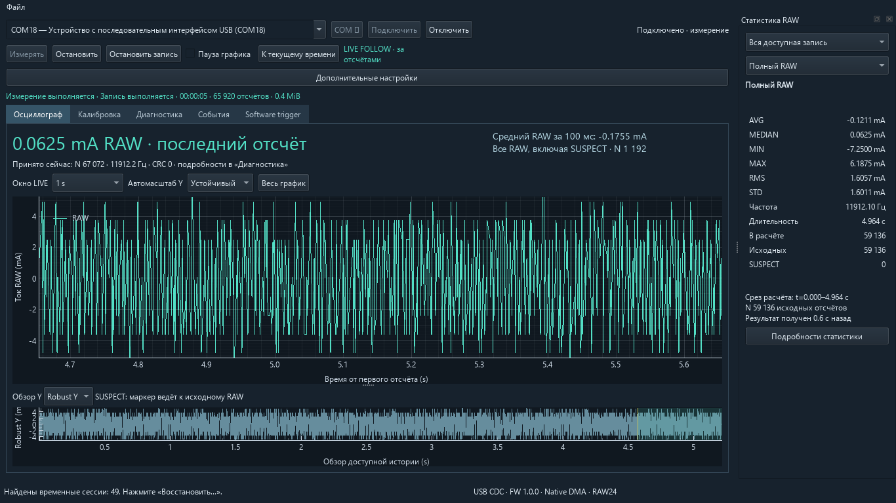
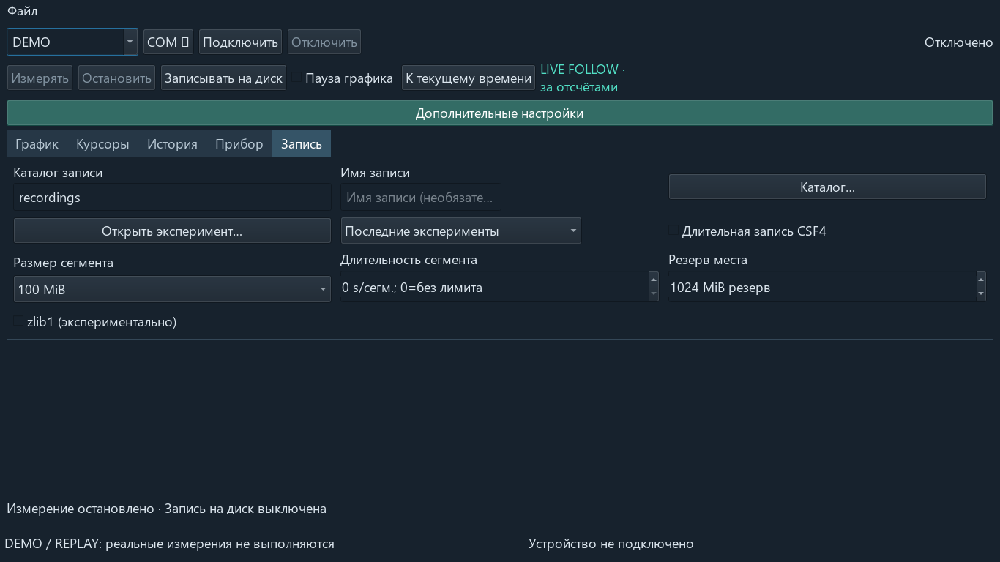

# CurrentSensor 1.0.0

USB-?????????? ???? ?? **STM32F411RET6 + INA229** ? Python GUI ??? ??????????,
?????? ? ??????? ???????? ?????????. Firmware 1.0.0 ? GUI 1.0.0 ???????? ??
?????????? FW 0.5.0 / GUI 0.6.2a; ????? ????????????? ??????? ? ?????? ???.

[GitHub Release v1.0.0](https://github.com/AlexeyNV/CurrentSensor_FW/releases/tag/v1.0.0)
? [?????????? ?????? ELF](docs/RELEASE_VALIDATION_1.0.0.md)
? [Release notes](RELEASE_NOTES_1.0.0.md)
? [????????? ??? ?????](docs/HABR_MATERIALS.md)

## ?????????? ?????

STM32F411RET6 ????????? INA229 ?? SPI1, mode 1, 6 ???. ???? ? **5 ???**.
ALERT ???????? ? ?????????? ??????????; SPI DMA ?????? RAW24, TIM2 ??????
????????? ????? MCU. ????? USB CDC ???????? ??????? ? ???????? ?????????.

? ??????????????? ????? USB-???????? ????????? ?? **ADUM3160BRWZ**, ?????????????
??????? ? **B0505S-1WR3L**. ??? ???????? ????????????? ?????, ? ?? ????????? ?
??????????? ????????????? ???????????? ??? ????????? ?????????.
[?????, Gerber ? ???????????](docs/HARDWARE.md).

## ??????????? ????? ? ???????????

- `App/`: acquisition, INA229, ????????? ??????, transport ? Flash-??????????;
  ??? RTOS ? ???????????? ??????, ?????????? ? CubeMX USER CODE.
- `current_sensor/`: ???? ???????? serial, ????????? RAW, ??????? ?????? ? Qt GUI.
- `tools/`: CLI, ????? CSF4 decoder, HIL, ??????-?????? ? ?????????? ??????.
- CSF4 v1 ????????? CODE ? ???????? timestamps; Native ?????????? CSF4 v2 ?
  ?????? RAW24, CRC32, ????????????????????, CONFIG/STATS ? ??????????? END.
- ???????, X/Y ???????, MIN/MAX/AVG/RMS ?? ??????? RAW ????? X1?X2, GAPS,
  Robust Y / Full RAW, LIVE FOLLOW/MANUAL ? Freeze ??? ????????? ??????.
- SUSPECT ? ??????????????? ??????????. RAW ?? ????????????; Display Clean ?
  ?????????? ??? SUSPECT ???????? ?? ????????? ????.
- ???????? ?????? CSV/RAW/CSF4 ? JSON metadata; ???????????????? ????? CSF4 ?
  `session.json`, ????????, ???????? ? ??????????? COMPLETE/PARTIAL/DISK_ERROR.
- ??????? ????????? ???????/??????? ? PNG. ??????? ?? ???????? ???????? ??? RAW,
  ? ?? ??????????? ???????? ??????.

????????? ?????? ?????? ????????? **?????? ???????? ????**: ?????? ??? ????????
??? ???????? ?????? ??????? ??? ?????????? ??????. ????????? ???? ???????? ??
?????????; ???????? ?????? ????????, ???????? ? ????????? ????????? ???????????.

## ????????? ? ??????

??????????? ?????: Windows 10, CPython 3.12, ??????????? ?? lock-?????.
Windows 11 ?? ?????????? ????????. ????? ????????? USB CDC ? ????????? COM.

```powershell
py -3.12 -m venv .venv
.\.venv\Scripts\python.exe -m pip install -r requirements-lock.txt
.\.venv\Scripts\python.exe -m current_sensor
```

1. ???????? COM ??????? ? ??????? ????????????. ???? ??????????? ????????? ?? ?????????.
2. ???????? ??????????????? ????????? ? ???????, ???????? **Native DMA ? 84 us ? CSF4 v2**.
3. ??????? ?????????? ???????? ??? ??????????. Native preset ???????? FAST,
   DMA, VSHCT=84 ???, ALATCH=1, VERIFY OFF; ??????????? ??????? ????? 11912 ??.
4. ??? ?????????? ???????? ???????/??? ? ????????, ??? ????????????? ????????
   ??????????? ?????? CSF4?, ????? ??????????? ?? ?????. ?????? ? ????????? ?
   ????????? ????????; ?????? ???????? ?? ????????????? ??.
5. ???????????? ????????? acquisition ? ???????? END. ????????? ??????????? ??????.
6. ???????? ???????????? ?????? JSON ???????? ?????? ???? `session.json` ??????.
   ????? ???? ?????? ??????????? ???????, ????????? ??????? ? PNG.

GUI ? PuTTY/CLI ?? ?????? ???????????? ??????? ????? COM. ?????? ????????????
???????????? ? ???????? ? ?? ????????? COM ??? ?????????????. ????? ?????????
USB disconnect ???????? ????? ??????????/????????? ???????????, ??? ?????? Reset.

DEMO ??? ????????????: `python -m current_sensor --demo`. Replay ?????????????
??????: `python -m current_sensor --replay recordings/session.csf4`. DEMO/REPLAY
???? ????????????; ?? ??????????? ?? ???????? ?? ????? ?????????? ?????????.

### ??????

| GUI preset | ??????? / ??????? | ???????? ? ??????????? |
|---|---|---|
| Native DMA 84 us | FAST preset, ?????????? ?11912 ?? | v2 RAW24, ALERT-driven, ?? ??????????????? ? TIM3 |
| DMA continuous | FAST 10000 / BALANCED 5000 / PRECISION 2500 / LOW_NOISE 1000 ?? | v1; ??????? ?????????? ???????? FW 0.5.0 ???????? |
| POLL continuous, ??????????? | PRECISION 2500 / LOW_NOISE 1000 ?? | v1; ???????? ???????? FW 0.5.0 ???????? |
| POLL BALANCED | ???? 5000 ?? | ???????????????; ? HIL ???? ??????, ?? ??????????? ????? 5 ??? |
| POLL FAST | acquisition ???????? ? CLI | GUI streaming ??????????? ?? ??????: ???????? ????? END |

??????????? POLL FW 0.5.0 ????????? ??? 1.0.0; firmware ????????? ?? ????????.
???????? ?????????? smoke ????????? ? Native, ?? ?? ???? ???????????.
?????? ??????????????? capture-????? ???????? ?? ???????? GUI streaming presets.

### ??????? ? ??????????

??? 5 ??? ???????? ???: `I_raw_nA = VSHUNT_CODE * (ADCRANGE ? 15625 : 62500)`.
??????????? ??????????: `(I_raw_nA - offset_ua*1000)*gain_ppm/1000000`, ?
????????????? ???????????. ??? disabled ????????? ????? ?????????. ? `measure`
`CURRENT_mA` ???????? RAW, `CURRENT_CAL_mA` ? ???????? ??????????????? ???.
??????? `cal show/set/enable/save/load/reset` ?????????; ?????? ????? `cal save`
????? Flash ? ???????? ?? ????? acquisition. ?????????????? ?????????? ???.

## ?????? ? ?????????? ????????

????? GNU make, GNU Arm toolchain ? STM32CubeProgrammer ? PATH. ?????????
STM32CubeCLT 1.22.0, GCC for STM32 14.3.1 ? CubeProgrammer **2.23.0**.

```powershell
make -j4
# ????????????? ???? ? stripped ELF, ??????????????? release-?????????:
.\.venv\Scripts\python.exe tools/release_prepare.py
```

?????? ?????????? `SOURCE_DATE_EPOCH=1794614400`, ????????? build-??????? ?
`objcopy --strip-debug`; ???????????? release manifest ?? ??????????????.
????????? ?????? ?????? ???? ?????? ???? ??? ?? ELF SHA-256:

```text
a0017ea7cbbc4419de551c9fd26c165702cf50f12131bc2b91db0fc49971a433
```

????????? ?? Release ELF ???????? ? SHA256SUMS ????? `Get-FileHash -Algorithm SHA256`.
??????? ?????? ??? ????????????? ???? ????? ?????????? ?? ?????????????? build.

**?????? 7 (0x08060000?0x0807FFFF) ???????? ??????????.** Linker ????????????
?????????? ??????? 384 KiB. ?? ???????????? mass/full chip erase, ????????
??????? 7 ??? ????????? option bytes. ????????? ????????? ????? ???????????.

?????????? ????? ? ????????? ROM DFU ????? BOOT0/RESET. `STM32_Programmer_CLI -l usb`
??????? serial. ? ????????? ??????? ???????? `SERIAL_FROM_DFU_LIST` ????????
???????? ??????? ????????????? ???????? STM32:

```powershell
.\.venv\Scripts\python.exe tools/hil/run.py --flash --approve-flash --dfu-serial SERIAL_FROM_DFU_LIST --suite smoke --runs 1 --expect-fw 1.0.0 --elf release/v1.0.0/CurrentSensor_FW_1.0.0.elf
```

??????????? ????????? ???????????? ID 0x0431, ????????? ?????? ELF, ?????? ????
?????? 7 ? ??? SHA-256, ??????? ?????? ???????????? ??????? ??????????,
????????? `--skipErase -d ... -v`, ???????? ?????? ?????? 7 ? ?????????? ????.
????????????/???????? backup ????????? ???????????. ?????? programmer ??????????
???????????; ????? ?? ??????? ???????? ?????? mass erase. ????? ?????? ???????
BOOT0 ? ?????????? ????????? ????? ????????? Reset.

????????? `info`, `ina`, `regs`, `measure`, ????? Native streaming:

```powershell
.\.venv\Scripts\python.exe tools/hil/run.py --suite stream --seconds 60 --runs 1 --expect-fw 1.0.0 --elf release/v1.0.0/CurrentSensor_FW_1.0.0.elf
```

USB COM ? DFU ? ?????? ????????? ??????????. ?????? backup/log/RAW ???????????
? ????????? `results/`; ??? ????????? ?? Git ? ?? ???????????? ? Release.

## ?????????? ?????????

**????? ELF 1.0.0:** smoke PASS; ?? 60 ? ???????? 715505 ???????????, 11912.2354 ??,
END, ???? CRC/frame/sequence/timestamp ? SPI/DMA errors, runtime losses ?
????????????. SHA-256 ??????? 7 ??/????? ??????. GUI streaming, ??????,
????????? ??? ?????? ? Disconnect/Reconnect ?????????.
**??????????????:** 45 ?????????? ???????????? service budget ? 4 ??????????????
RAW ?? ???? ????; ??? ?? ?????? ?? ??????????? PASS.

**????? ?????????? FW 0.5.0:** 300-????????? Native ????? ? 3574434 ???????,
????? 11912 ??, ???????? USB integrity ????????. ????????? ??????????? ??????
300 ? ????? 117 ?? ? 3573759 ????????. Fluke 17B+ ??/????? ????????? 0.117 A;
??????? RAW 116.078004 ??. ?????????? Fluke/??????????? ?? ????????????.
??? ???????????? ???????? ????? ?????, ?? ???????? ?10 ?? ??? ??????? ???????
??? ????? ????????? 0?10 ?. [???????????](docs/ACCURACY_100MA.md).

[??????????? ????? 1.0.0](docs/RELEASE_VALIDATION_1.0.0.md) ?
[????????? ????????/????](docs/releases/v1.0.0/validation.json).
?????????: **130 GUI + 49 CLI/HIL + 16 C ?????? PASS**.

```powershell
.\.venv\Scripts\python.exe -m unittest discover -s tests_gui
.\.venv\Scripts\python.exe -m unittest discover -s tools -p "test_*.py"
cmake -S tests -B tests/build
cmake --build tests/build --config Release -j4
ctest --test-dir tests/build -C Release --output-on-failure
```

C-????? ????????? ? MSVC / Visual Studio 2022. ????????? Qt-???????? 100/125/150%
?? 1366?768, 1694?1188, 1920?1080 ?????????? 45 ????????? ???????? ??? ?????????
????; ?? ???????? ????????????? ???? ????????? Windows DPI.

## ????????? ???????????

- ???????? ?????? RAW-???????? ?? ???????????; firmware ?? ?????????/?? ?????????? RAW.
- Native ????? ?????????????? ?????????? ???????. Timestamp ????????? ????????????
  ?????????? MCU, ?? ?????? ?????? ?????????? ?????????. ?? ????????????? ??????????
  ????????? ???? ?????????? ????????? INA229.
- ????? ????? ????????????? ???????? PARTIAL ??-?? Native STOP-discard ??? ??????
  ?????????? ???????? RAW ? END. ?????? ? ???????? ?? ??????????? ?? COMPLETE.
- POLL/FAST streaming ???????? ? GUI; POLL/BALANCED ????? ??????.
- ??????????????? ???????? ??????????: ?????? ?????????? ?? ??????, ??????? ???? ?
  ????????????? ???????? ?? 0?10 ? ? ??????????? ??????. ????? ????? ????????????
  ? 1.0.0 ???. ????????? ????????????? ???????????? ?? ???????????.

## ????????? GUI 1.0.0

??????? ?????: ????????? ?????????? streaming FW 1.0.0.



????????? ?????? ?????? ???????? ????; ???? DEMO ??? ?????? 150%:



[?????? ??? ???????? ? DEMO](docs/images/v1.0.0/settings_inline.png) ?
[???????? ?????????? ?????? ? REPLAY](docs/images/v1.0.0/archive.png) ?
[?????? ????? ??????????? ???? ? REPLAY](docs/images/v1.0.0/current_plot.png) ?
[??????? ? REPLAY](docs/images/v1.0.0/cursors.png) ?
[?????????? ? REPLAY](docs/images/v1.0.0/statistics.png) ?
[SUSPECT ? REPLAY](docs/images/v1.0.0/suspect.png).
[????????????? ???????????](docs/images/v1.0.0/sources.json).

## ???????? ? ?????????? ??????

??????????? ??? ? [MIT](LICENSE), ????????? ?????????? ???????.
[???????? ????????? ???????????](docs/THIRD_PARTY_NOTICES.md) ????????? ????????.
????? ? Gerber ???????? ? [docs/gerber](docs/gerber).
???? ?????? ? ???????? ??????????? ?????????? ? [HABR_MATERIALS](docs/HABR_MATERIALS.md).
??????? ?????????? ?????? ? [????? README](docs/DEVELOPMENT_HISTORY.md).
????? ?????????? v1.0.0 ??????????? ?????; ????????? ????????????? ????????????
??????????? ? ??????????? ???????.
