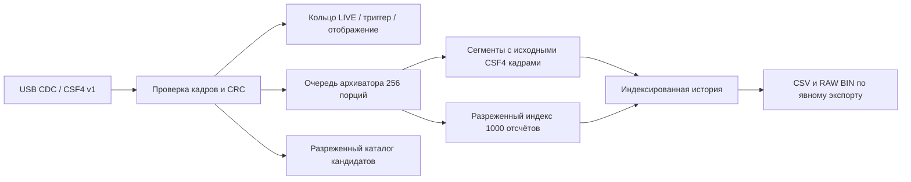

# CurrentSensor GUI v0.1.3 — долговременный архив

FW 0.4.3 и протокол CSF4 v1 не изменены. Архив работает на ПК. Аппаратные
испытания GUI v0.1.3 ещё не проводились.

## Потоки данных и дублирование

В коротком режиме v0.1.2 один поток CSF4 декодировался в live-кольцо, временный
полный RAW spool и одновременно записывался как CSV, RAW BIN и CSF4. Детектор
хранил один байт маски на каждый отсчёт. При 10 кГц это около 17,3 ГБ RAW BIN,
6,2 ГБ CSF4 и более 30 ГБ CSV за сутки плюс spool и память маски.

В **длительном** режиме данные идут так:



Один поток владеет COM-портом; запись на диск выполняется отдельным потоком.
При запуске долгой записи **до** измерения временный RAW spool не создаётся.
Короткая запись остаётся совместимой и сохраняет прежние CSV/RAW/CSF4/JSON.
Исходные коды не фильтруются. В памяти остаётся ограниченное live-кольцо, а
детектор долгой записи хранит события без побайтной маски всех отсчётов.

## Использование

1. Запустите `python -m current_sensor`, выберите COM-порт и каталог записи.
2. До кнопки «Измерять» включите «Длительная запись CSF4» и кнопку записи.
3. Оставьте сегмент 100 MiB, лимит времени 0 и резерв диска 1024 MiB либо
   задайте другие значения. Допустимы 25/100/250/500/1024 MiB. `zlib1` пока
   экспериментален и выключен по умолчанию.
4. Выберите профиль и DMA/POLL, запустите измерение. Строка архива показывает
   время, N, записанный объём, сегмент, среднюю скорость, свободное место,
   потери архива, CRC и пропущенные slots. Статусы: `RECORDING`, `FINALIZING`,
   `COMPLETE`, `PARTIAL`, `DISK_ERROR`.
5. Во время записи доступны Live, Freeze, zoom, курсоры, триггер и сохранение
   участка. Freeze фиксирует записанный префикс индекса в фоне; последние ещё
   не записанные данные видны в live-кольце до переключения на архив.
6. Остановите измерение, дождитесь `COMPLETE` или `PARTIAL`, затем откройте
   `archive_*/session.json` через «Открыть эксперимент…». Один каталог архива
   отображается как одна осциллограмма. Перейти к произвольному времени можно
   масштабированием, Auto X и курсорами. Обзор берётся из индекса min/max.

Медианные линии считаются из RAW при приближении к участку до 100 тысяч
отсчётов, с несколькими предшествующими отсчётами для непрерывности фильтра.
При более широком обзоре явно показывается RAW envelope. Статистика курсоров
и ROI всегда рассчитывается по всем доступным исходным отсчётам выбранного
интервала; границы включаются. Пропущенные слоты не интерполируются.
Сохранение участка создаёт CSV, RAW BIN, JSON и каталог кандидатов только по
явному запросу. Экспорт полного суточного архива может занять значительное
время и потребовать много места.
Статистика «RAW без кандидатов» вычитает события из сумм/сумм квадратов
индекса, а для min/max читает только затронутые блоки. Если каталог ещё
обрабатывается или неполон, обработанная статистика явно помечается неполной.

## Состав архива и индекс

```text
archive_YYYYMMDDTHHMMSS_xxxxxxxx/
  session.json              атомарно заменяемый manifest
  samples.idx               записи по 108 байт с CRC32
  segment_00000.csf4        исходные кадры, без изменения CRC/sequence/TIM2
  segment_00001.csf4        следующий сегмент той же аппаратной сессии
  candidate_events.jsonl    необязательный каталог кандидатов
```

При `zlib1` или `zlib3` расширение сегмента `.csfz`. Каждый независимый блок
содержит заголовок `CFB1`: длину RAW, длину сжатых данных, CRC32 обеих частей
и число кадров. Внутри — исходные CSF4 кадры целиком, включая их CRC. Ротация
идёт между блоками и никогда не делит кадр. Сжатый архив не является одним
длинным zlib-потоком: короткий участок распаковывает только затронутые блоки.

`session.json` версии схемы 1 содержит ID исходной сессии, FW, подтверждённый
профиль INA229, частоту/период, DMA/POLL, калибровку, UTC старта, настройки,
список сегментов с размерами, CRC32 закрытого сегмента, первыми/последними
slot и расширенным временем, счётчики транспорта и прибора, ошибки, признак
END, полноту и сведения о восстановлении. Промежуточные сегменты **не** имеют
собственного END; END относится ко всей аппаратной сессии. Новые CONFIG/END
не создаются. Разные запуски прибора всегда получают разные каталоги.

`samples.idx` разрежен примерно до одной записи на 1000 отсчётов (0,1 с при
FAST). Запись указывает сегмент и byte offset, диапазон 64-битного времени,
слотов, число отсчётов/кадров, точные времена min/max, сумму кодов, сумму
квадратов и разрывы. Для курсоров крайние блоки читаются из CSF4, целые
внутренние блоки суммируются по индексу. Время графика и индекса разворачивает
32-битный TIM2 в 64-битную шкалу по соседним исходным отсчётам; поле TIM2 в
кадре не меняется. Доступ по времени: `ArchiveReader.locate_time`, по slot:
`locate_slot`; последнее предполагает менее 2³² слотов на сессию (около
4,97 суток при 10 кГц). При перерыве без отсчётов длиннее одного оборота TIM2
число оборотов нельзя однозначно восстановить из CSF4 v1.

`COMPLETE` требует проверенный END, запись всех полученных отсчётов, старт
архива с начала аппаратной сессии и отсутствие отмеченных транспортных,
измерительных или дисковых потерь. Иначе `PARTIAL`; `DISK_ERROR` означает
ошибку записи или недостаток резерва. `candidate_events.jsonl` — гипотезы о
выбросах, а не свидетельство повреждения SPI/CRC. При большом числе событий
каталог ограничен 100 тыс. записей и помечается неполным.

## Сбой, проверка целостности и старые файлы

Manifest записывается через временный файл и атомарное переименование;
закрытые сегменты и подтверждённый префикс индекса остаются доступны после
сбоя. Если индекс удалён/повреждён или запись прервалась, открытие проверяет
исходные кадры/CRC, пересоздаёт индекс и отмечает `recovered`, `partial` и
`recovery_errors`. Исходные сегменты не исправляются и не стираются. Неполный
хвостовой кадр исключается; предыдущие целые кадры сохраняются. При обычном
быстром открытии полная проверка всех гигабайт сегментов не проводится:
каждый декодируемый блок проверяется при чтении, а восстановление пересканирует
весь архив. Скопируйте архив перед ручным вмешательством в его файлы.
Если сегмент отсутствует, восстановление сохраняет более поздние доступные
сегменты и их известные временные привязки, но выставляет
`time_continuity_uncertain`: непрерывность через потерянный файл не доказана.

Для полной проверки закрытых сегментов без изменения архива выполните:

```powershell
.\.venv\Scripts\python.exe -m tools.verify_archive_013 recordings\archive_NAME\session.json
```

Отчёт отдельно показывает `crc_ok` для записанных файлов и
`session_complete` для исходной сессии. Поэтому архив с потерянным slot может
иметь целые файлы (`crc_ok: true`) и оставаться частичным.

При переполнении очереди архиватор отмечает потерянные отсчёты и прекращает
запись. USB/acquisition продолжают работать; доступный live-буфер можно
экстренно экспортировать. После заполнения диска более ранние закрытые блоки
остаются доступны. Сессия явно остаётся частичной.

Старые `.csv`, `.raw.bin` и `.json` открываются прежним путём. Одиночный
`.csf4` теперь тоже импортируется с проверкой CRC в производный временный
кеш; исходный файл не меняется. Для крупных старых файлов импорт может
потребовать дополнительное место в temp. Миграция необязательна: храните
старые JSON рядом с указанными в них файлами; для новой записи выбирайте
длительный режим. Конвертацию старых RAW/CSV в настоящий CSF4 архив без
исходных CSF4 кадров не выполняем, поскольку нельзя восстановить исходные
CRC, sequence и кадры.

## Ограничение длительности FW 0.4.3

В текущем FW `ACQ_ELAPSED_US` и `STREAM_ELAPSED_US` вычисляются как 32-битная
разность TIM2 (`App/Src/app.c`, `App/Src/acquisition.c`) и передаются 32-битными
полями CSF4 END. Они переполняются через **4294,967296 с ≈ 71 мин 34,97 с**.
После этого длительность и производная частота в итоговой диагностике прибора
могут быть неверны, хотя GUI продолжает разворачивать соседние TIM2 метки.
Счётчик slot при 10 кГц переполнится примерно через 4,97 суток.

Минимальное совместимое исправление в отдельной задаче FW: счётчик
переполнений TIM2 и 64-битная длительность; новые текстовые поля вроде
`ACQ_ELAPSED_US64` / `STREAM_ELAPSED_US64`, при сохранении старых CSF4 v1
полей по модулю 2³². Для однозначной длительности в **самом бинарном END**
нужен отдельный новый тип кадра или CSF4 v2. FW в этой версии GUI не менялась.

## Аппаратная проверка

Закройте PuTTY перед GUI, чтобы COM-порт имел одного владельца. Сохраните
Flash-калибровку и подтвердите `info`, `cal show`, `acq config`, `measure` до
теста. Для каждого опыта сохраните `session.json`, итоговый `stream status`,
`stream timing`, `stream anomaly`, размер архива и нагрузку CPU/RAM/диска ПК.

```text
# PuTTY, до запуска GUI
info
cal show
acq config
measure

# Закрыть PuTTY; запустить GUI, выбрать FAST + DMA и длительную запись
python -m current_sensor --port COM5

# После остановки и закрытия GUI снова открыть PuTTY
stream status
stream timing
stream anomaly
cal show
measure
```

1. FAST DMA 10 минут с сегментом 25 MiB: проверить ротацию, все кадры/CRC,
   количество принятых и архивированных отсчётов, отсутствие потерь на границе.
2. FAST DMA 90 минут: пройти один rollover TIM2, сверить 64-битное время GUI,
   slot gaps и ожидаемое ограничение 32-битного отчёта FW.
3. FAST DMA 3 часа: Freeze/Live, курсоры и экспорт импульса через сегменты.
4. FAST DMA 6–12 часов: финальный soak-test, резерв диска, память и очередь.
5. Повторить короткие сеансы BALANCED/PRECISION/LOW_NOISE.

Для каждого сравнивайте `SAMPLES`, архивные `sample_count`, `CRC_ERRORS`,
`FRAME_GAPS`, `LOST_SAMPLE_SLOTS`, `ACQ_BUFFER_OVERFLOWS`, USB-потери,
`recorder_dropped_samples`, `slot_gaps` и ошибки DMA/SPI. `COMPLETE` не заменяет
эту сверку. После остановки также запустите `tools.verify_archive_013` на
`session.json`. Аппаратное подтверждение 10 кГц для GUI v0.1.3 пока отсутствует.

[Замеры ПК и тесты](GUI_0.1.3_BENCHMARK.md).
